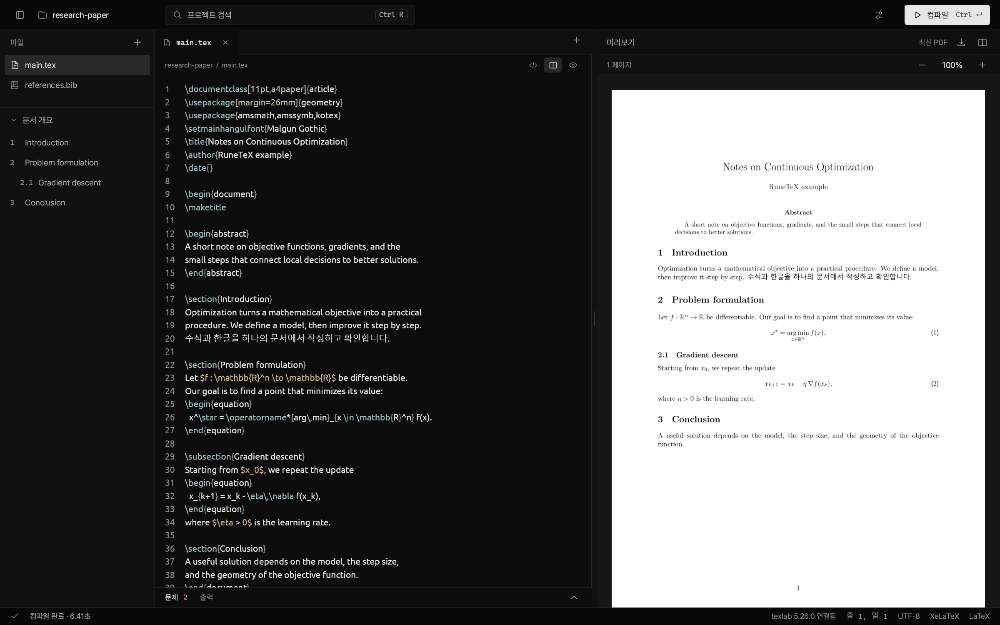
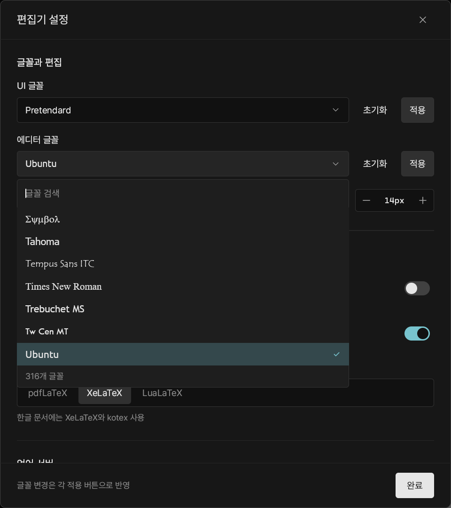

<p align="center">
  
</p>

<h1 align="center">RuneTeX</h1>

<p align="center">
  소스와 PDF를 나란히 보는 Windows용 LaTeX 편집기
</p>

<p align="center">
  <a href="https://github.com/wnsnaissante/RuneTeX/releases/latest"><strong>Windows 다운로드</strong></a>
  &nbsp;·&nbsp;
  <a href="#시작하기">시작하기</a>
  &nbsp;·&nbsp;
  <a href="docs/DEVELOPMENT.md">개발·배포 안내</a>
</p>



<p align="center">
  <sub>Rune 기반 Rust 네이티브 앱 · Windows x64 · XeLaTeX · UTF-8</sub>
</p>

## 쓰면서 확인하는 LaTeX

문서 구조를 따라 소스를 편집하고, 컴파일한 PDF를 같은 창에서 확인합니다. 탐색기·파일 탭·문서 개요로 프로젝트 안을 이동하고, 소스와 미리보기 사이의 분할선을 조절해 필요한 쪽을 넓게 볼 수 있습니다.

- **문서 구조 탐색** — 프로젝트 파일과 `1`, `2`, `2.1` 계층의 문서 개요에서 소스로 이동
- **texlab 언어 지원** — 자동완성, 오류 진단, 명령 설명과 정의 이동
- **PDF 미리보기** — 페이지 제한 없이 보이는 부분부터 불러오고, 배율 조절·PDF 내보내기 지원
- **편집 환경 설정** — UI·에디터 글꼴을 각각 미리 보고 선택하고, 글자 크기를 단축키로 조절

<details>
<summary>글꼴·편집 설정 화면 보기</summary>



UI 글꼴과 에디터 글꼴은 독립적으로 설정합니다. 각 글꼴 이름을 해당 글꼴로 미리 보고 선택한 뒤 적용할 수 있습니다.

</details>

## 시작하기

1. [MiKTeX](https://miktex.org/download) 또는 [TeX Live](https://www.tug.org/texlive/)를 설치합니다.
2. [최신 릴리즈](https://github.com/wnsnaissante/RuneTeX/releases/latest)에서 Windows x64 설치 EXE를 다운로드해 실행합니다.
3. RuneTeX에서 문서를 편집하고 `Ctrl+Enter`로 저장·컴파일합니다.

설치 파일에는 **texlab과 Poppler**가 포함됩니다. 기본 엔진은 **XeLaTeX**이며, 문서는 **UTF-8**로 저장합니다. 한글 문서에는 `\usepackage{kotex}`를 사용하세요. 기본 예제에는 이미 적용되어 있습니다.

설치 경로와 바로가기를 선택해 현재 사용자 계정에 설치합니다. Windows **설정 → 앱 → 설치된 앱**에서 제거할 수 있으며, 사용자 문서와 개인 설정은 유지됩니다.

## 자주 쓰는 단축키

| 단축키 | 동작 |
| --- | --- |
| `Ctrl+S` | 저장 |
| `Ctrl+Enter` | 저장 후 컴파일 |
| `Ctrl+Space` | 자동완성 |
| `F12` | 정의로 이동 |
| `Ctrl++` / `Ctrl+-` | 에디터 글자 크기 조절 |
| `Ctrl+K` | 프로젝트 검색 |

## 개발과 배포

Rust **1.99.1**과 MSVC 도구 모음으로 빌드합니다. 실행 환경, LSP·PDF 도구 경로, 설치 파일 생성과 릴리즈 본문 작성은 [개발·배포 안내](docs/DEVELOPMENT.md)에 정리되어 있습니다.

```powershell
.\scripts\Run-RuneTeX.ps1
```

PDF 미리보기는 화면에 보이는 페이지와 주변 페이지를 먼저 불러오고 캐시합니다. BibTeX·Biber 자동 실행과 엔진별 패키지 설치 범위 등은 [컴파일 범위](docs/DEVELOPMENT.md#컴파일-범위)를 확인하세요.

## 라이선스

RuneTeX는 [MIT 라이선스](LICENSE)로 배포합니다. 동봉한 구성 요소의 라이선스와 저작권 고지는 [Third-party notices](THIRD-PARTY-NOTICES.md), 원본 소스 링크는 [소스 목록](licenses/SOURCES.md)에서 확인할 수 있습니다.
